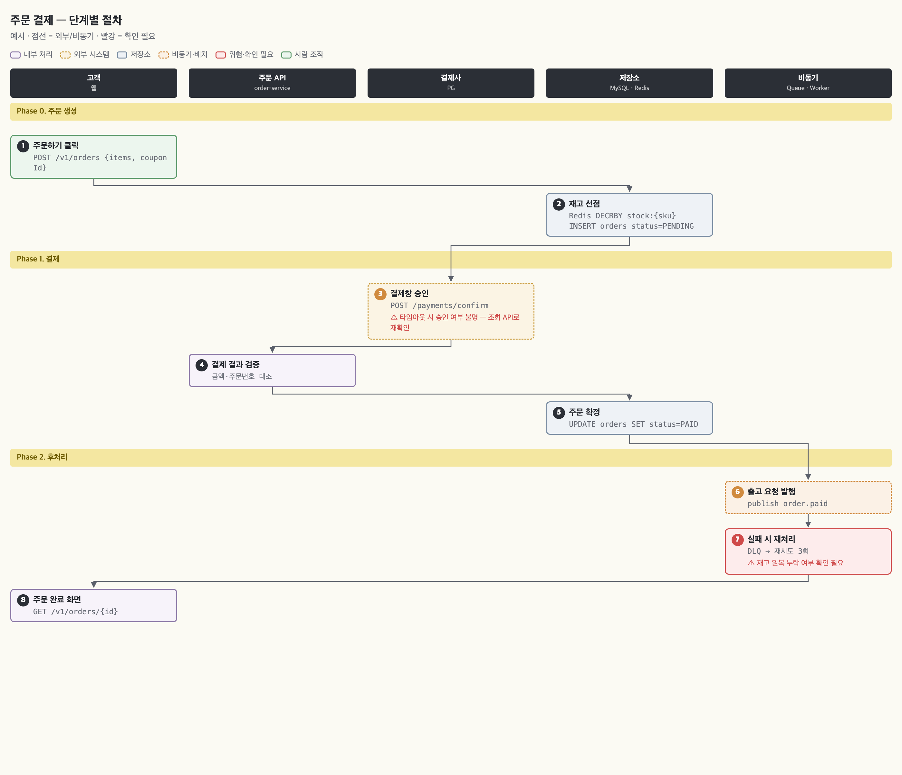

# swimlane skill

단계별 절차를 스윔레인 한 장(HTML + PNG)으로 그려 주는 에이전트 스킬입니다. Claude Code와 Codex에서 모두 동작합니다.
"이 배포 절차 스윔레인으로 그려줘", "주문 흐름 누가 어디서 뭘 하는지 그려줘"처럼 말하면, 에이전트가 코드·문서를 읽어 실제 단계를 뽑고 그림을 만듭니다.



- 레인(열) = 실제 실행 주체, Phase 띠 = 멈추고 확인하는 지점, 번호 카드 = 한 주체의 한 동작(실제 API·SQL 줄 포함)
- 점선 = 외부·비동기, 빨강 = 위험·미확인, 초록 = 사람 조작
- 필요한 것: **Node.js 18+** 하나. PNG는 설치된 Chrome/Chromium/Edge로 찍습니다(없으면 HTML만).

## 설치

### 한 줄 설치 (Claude Code · Codex 등)

```bash
npx skills add sp-daewoon/swimlane-skill --skill swimlane
```

### 직접 복사

```bash
git clone https://github.com/sp-daewoon/swimlane-skill
# Claude Code
mkdir -p ~/.claude/skills && cp -R swimlane-skill/skills/swimlane ~/.claude/skills/
# Codex
mkdir -p ~/.codex/skills && cp -R swimlane-skill/skills/swimlane ~/.codex/skills/
```

설치 후 에이전트를 다시 시작하세요. 프로젝트에만 넣으려면 `.claude/skills/swimlane` (Claude Code) 또는 `.codex/skills/swimlane` (Codex)에 복사합니다.

## 사용

에이전트에게:

> 이 레포의 결제 승인 흐름을 스윔레인으로 그려줘

직접 실행:

```bash
node ~/.claude/skills/swimlane/scripts/swimlane.mjs ~/.claude/skills/swimlane/examples/checkout.json --png --out ./checkout
```

| 옵션 | 뜻 |
|---|---|
| `--check` | spec 검사만 |
| `--png` | HTML과 PNG(2배 해상도) 생성 |
| `--out <경로>` | 확장자 없는 출력 경로 |
| `--no-open` | 브라우저 자동 열기 끔 |

PNG가 안 나오면 `CHROME_PATH=/path/to/chrome`을 지정하세요.

spec 형식은 [SKILL.md](skills/swimlane/SKILL.md)를 보세요.

## License

MIT
